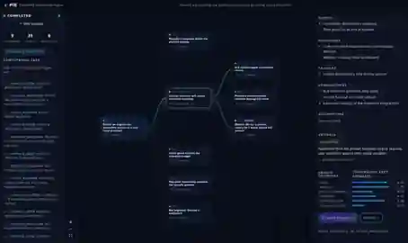

# Possibility Intelligence Engine (PIE) — Vertical Slice

**Implements §20 "First Development Milestone" of the PIE Implementation
Specification v1.0**: a user can enter a decision, watch *real* backend
events draw animated possibility branches, inspect a branch's causes and
evidence, expand it, and fork a what-if alternative **without destroying the
original analysis**. No static mockups — every node, edge and animation is
driven by persisted backend events.



---

## Run it

```bash
# 1. Backend (FastAPI, port 8000)
cd backend
pip install -r requirements.txt
python -m uvicorn main:app --host 0.0.0.0 --port 8000

# 2. Frontend (Vite dev server, port 5173 — proxies /v1 to the backend)
cd frontend
npm install
npm run dev
```

Open http://localhost:5173 — or use the live preview.

### Tests

```bash
cd backend && python -m pytest tests/ -q      # 8 unit/integration tests
cd backend && python tests/e2e_smoke.py       # Playwright end-to-end journey
```

---

## What works today

| §20 Milestone step | Status |
|---|---|
| 1–3. Open UI, enter decision, submit | ✅ root input with seeded demo scenarios |
| 4–5. Root activates; branches appear from live SSE events | ✅ sequenced events, replay, keep-alive |
| 6–7. Select a branch; inspect causes/conditions/consequences | ✅ full inspector with evidence + assumptions |
| 8. Expand that branch → secondary consequences | ✅ `POST /v1/scenarios/{id}/expand` |
| 9–10. Change an assumption → alternative without destroying the original | ✅ `ALTERNATIVE_TO` + `MODIFIES` edges; originals provably intact (asserted in e2e) |

**Integrity guarantees encoded in code and tests**

- **No fabricated probabilities.** `ProbabilityObject` rejects an unquantified
  estimate (`estimate must be None`) and requires a declared method for any
  quantified one. Most scenarios ship `unquantified` — by design.
- **One honest quantified model.** Cash-runway Monte Carlo (4 000 seeded
  samples) produces a `model_based` P(cash out ≤ N months) for cash-critical
  business branches, with every input distribution disclosed as a blocking
  assumption. Deterministic per (analysis, node) — reproducible per §16.5–6.
- **Graph validation.** Missing parents/edges, duplicate sibling scenarios,
  self-edges, and event-flow cycles are rejected. Cross-reference edges
  (`MODIFIES`, `ALTERNATIVE_TO`, `CONTRADICTS`) are exempt from acyclicity
  because they legitimately point backwards (§5.1).
- **Persist-before-publish events.** Every event gets a sequence number in an
  append-only log before any subscriber sees it; SSE supports `Last-Event-ID`
  and `?last_event_id=` replay. The frontend never invents an event — the
  animation is only as honest as the bus (§9.1).
- **Explicit unexplored markers.** Branches beyond depth/node/coverage limits
  are marked `unexplored`, surfaced in the UI, never presented as complete.

## Architecture (this slice)

```
frontend/  React + TS + @xyflow/react + Zustand
  src/components/   custom scenario nodes, rainbow-flow edges, inspector,
                    status rail, root input
  src/stores/       event → graph projection, snapshot reconciliation
  src/services/     REST + EventSource (Last-Event-ID replay)

backend/   FastAPI + Pydantic
  app/api/          REST + SSE surface (§10)
  app/core/         orchestrator (§6 workflow), event bus (§9), config
  app/graph/        scenario models (§5.2), validated in-memory store
  app/providers/    LLMProvider interface; mock + OpenAI-compatible adapters
  app/domains/      keyword domain resolver + deterministic discovery corpus
                    for the three §14 validation domains
  app/simulation/   seeded Monte Carlo cash-runway model
```

### Deliberate slice substitutions (honesty list)

| Spec target | Slice reality | Seam kept |
|---|---|---|
| LLM discovery (§2.D) | Deterministic rule-based `MockProvider` (offline, reproducible, schema-validated) | `LLMProvider.generate()` interface; drop in `OPENAI_API_KEY` + `PIE_PROVIDER=openai` to switch — no other module changes |
| PostgreSQL (§5.4) | In-memory `GraphStore` with validation | `GraphStore` API is the storage seam |
| Redis + Celery | `asyncio` background tasks | orchestrator interface unchanged |
| DoWhy / PyMC / NetworkX | Hand-rolled tree layout + one NumPy-free Monte Carlo | engines are independent modules (§2.F–G) |
| Auth (§10) | Permissive local mode | route dependencies in place |
| Motion for React / PixiJS | CSS keyframes + SVG gradient pulses | perf gate respected: no PixiJS until benchmarks demand it |

## Event vocabulary implemented

`analysis_started`, `domain_identified`, `possibility_discovered`,
`possibility_validated`, `evidence_added`, `estimate_updated`,
`simulation_completed`, `branch_expanded`, `branch_completed`,
`context_required`, `analysis_completed`, `analysis_cancelled`,
`analysis_failed` — each carrying `sequence`, `analysis_id`, `node_id`,
`parent_ids`, `timestamp`, `payload`.

## Configuration

| Env var | Default | Meaning |
|---|---|---|
| `PIE_PROVIDER` | `mock` | `mock` or `openai`/`openai_compat` |
| `OPENAI_API_KEY` / `OPENAI_BASE_URL` / `PIE_OPENAI_MODEL` | — | real-model adapter |
| `PIE_MAX_DEPTH` / `PIE_MAX_NODES` / `PIE_BEAM_WIDTH` | 4 / 60 / 6 | exploration limits (§6.3) |
| `PIE_PACE` | `0.55` | seconds between orchestration steps (scheduling only — never fabricates results) |

## Roadmap

This slice is Phase 1–3 core + the Phase 5 interface in miniature. Next per
the blueprint: Postgres persistence, real-model discovery under regression
harness (§3.3, §15 LLM regression tests), PyMC probability engine with
diagnostics, user memory with consent (§4), calibration/evaluation loop (§7.2,
Phase 7), and production hardening (Phase 8).
